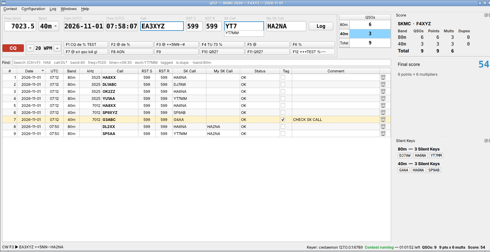

# qTLF

[English](README.md) · **Français**

**Logiciel de log de concours personnalisable** pour radioamateurs.

Un logueur de concours pour radioamateurs, écrit en Qt 6 / C++, inspiré de
[TLF](https://tlf.github.io/). Chaque concours est un dossier modifiable dans `rules/`
(définition JSON + calcul du score en JavaScript + fenêtres QML) : un nouveau concours ne
demande aucune recompilation.

L'interface existe en anglais, français, italien, allemand et espagnol (*Configuration › Language*).



## Fonctions

* **Fenêtre de démarrage** — ouvrir un concours existant ou en créer un à partir de n'importe quelle
  définition de `rules/` (règlement + date + indicatif + catégories Cabrillo + échange fixe). Les options
  d'en-tête Cabrillo du concours (opérateur, puissance, club…) se modifient ensuite dans
  **Configuration › Contest options…** (score et fenêtres suivent aussitôt) ; la date, l'indicatif,
  l'échange envoyé et les QSO n'y sont jamais modifiés.
* **Fréquence tapée à la main** (ou bande choisie dans le règlement).
* **Ligne de saisie** sur une seule ligne, en grands caractères : Fréq (kHz) / Bande · Mode ·
  Date (UTC) · Heure (UTC) · Indicatif · RST E · RST R · Échange reçu · Échange envoyé · bouton **Log**.
  * Le curseur démarre dans **Call** ; **TAB** passe de Call à l'échange reçu et inversement ;
    **ENTRÉE** enregistre avec la date/heure du moment ; **Ctrl+ENTRÉE** enregistre sans CW ;
    **ÉCHAP** efface ; **Ctrl+L** vide Call, l'échange et la recherche.
  * RST 599 par défaut (selon le règlement), modifiable. Échange envoyé = valeur fixe ou numéro de
    série 001, 002…
  * Listes déroulantes : **Call** = indicatifs du log, puis du fichier CSV `call_exchange` du concours ;
    **échange reçu** (optionnel) = échanges du log, puis de `call_exchange`.
  * TAB pré-remplit l'échange reçu 1. depuis le log de ce concours si la station a déjà été contactée
    (F5ABC = F5ABC/P), 2. depuis `call_exchange` ou un champ de cty.dat (zone CQ, zone ITU,
    continent…), selon contest.json (`"prefill": "none"` pour les numéros de série).
  * Alerte **DUPE** et bandes « déjà contacté » en direct pendant la frappe.
  * Comme TLF : une fréquence tapée dans Call (`7025`, `3.535`) fait un QSY ; `:commandes` (voir `:help`).
* **Contrôle du TRX** (Hamlib, Linux et Windows — `libhamlib.so.4` / `libhamlib-4.dll` chargée au
  démarrage) : la fréquence et le mode du poste remplissent la ligne de saisie (la bande suit), une
  fréquence tapée dans qTLF règle le poste. RIGMODEL / RIGSPEED / RIGPORT comme avec `rigctl`, ou
  `rigctld` par le réseau. *Configuration › TRX control*. Voir docs/BUILD-LINUX.md.
* **Fenêtre du log** — chaque cellule modifiable (double-clic), 🗑 suppression avec confirmation, case
  **Tag** + commentaire pour une vérification ultérieure, colonne de statut (OK, erreurs génériques
  trouvées par qTLF — DUPE, OUT OF PERIOD, BAND CHANGE, BAD EXCH… — ou statut propre au concours
  donné par le script).
* **Recherche intelligente** — `HA6`, `call:DL*`, `band:40`, `freq>7020`, `time>=06:30`,
  `date=2026-11-01`, `exch:YT7MM`, `tagged`, `is:dupe`, `is:invalid`, `-band:80m` … combinés en ET.
* **QSO par bande** résumés dans un coin.
* **Manipulateur CW** (cwdaemon en UDP) : messages F1–F12 avec macros, modes CQ / S&P avec une
  séquence ENTRÉE intelligente, auto-CQ (F12), vitesse ±1 WPM (PgUp/PgDn), DUPE → QSO B4 (F7),
  ÉCHAP arrête l'émission. Voir *Manipulateur CW* plus bas.
* **Séparation nette programme / concours** : l'exécutable gère la saisie, le manipulateur, le log,
  les contrôles génériques (bande, mode, périodes, temps minimum sur une bande, indicatif, échange,
  doublons), les fichiers de données et le Cabrillo ; chaque dossier de concours ne fait que déclarer
  ses données dans contest.json (périodes `start_utc`/`end_utc`, fichiers CSV, cty.dat, champs
  Cabrillo) et calculer son score dans scoring.js. Un nouveau concours = un nouveau dossier.
* **Fichiers de données** : tous en CSV (`call_exchange.csv` : stations connues et leur échange),
  sauf le cty.dat universel (continents, DXCC, zones).
* **Fichiers de données par le réseau** : tout fichier peut être téléchargé depuis une URL
  (ex. GitHub raw) à l'ouverture du concours ou par Ctrl+U ; hors ligne, la copie locale est utilisée.
* **Fenêtres personnalisées** dans des docks, écrites en QML par l'auteur du concours (tableau du
  score, multiplicateurs, taux…).
* **Export Cabrillo 3.0** avec un modèle de ligne QSO propre à chaque concours.
* **Export ADIF 3.1.8** (ADI, *Contest › Export ADIF*, Ctrl+Shift+A ou `:adif`) pour le carnet de
  trafic général (LoTW, QRZ.com, Log4OM…) : CALL, QSO_DATE, TIME_ON, BAND, FREQ, MODE/SUBMODE, RST,
  STX/SRX (numéro de série) ou STX_STRING/SRX_STRING, CONTEST_ID, STATION_CALLSIGN, MY_GRIDSQUARE,
  COMMENT, et le statut qTLF dans APP_QTLF_STATUS.
* **Langues** : anglais (par défaut), français (fr), italien (it), allemand (de), espagnol (es) ;
  *Configuration › Language*. Seule l'interface est traduite (règlements, fenêtres QML et codes de
  statut restent en anglais). Voir docs/TRANSLATING.md pour en ajouter une.
* Base **SQLite** unique (tous les concours dans un fichier), SQL portable, prête pour un serveur
  distant plus tard.

## Installation

**Windows 10 / 11** — téléchargez `qTLF-<version>-windows.zip` sur la page
[Releases](https://github.com/f8ehj/qTLF/releases), dézippez-le où vous voulez (ex. `C:\qTLF`) et
lancez `qtlf.exe` (clic droit › *Envoyer vers › Bureau (créer un raccourci)* pour un raccourci).
Rien n'est installé dans Windows : logs et réglages sont dans `%LOCALAPPDATA%\qTLF` et
`%APPDATA%\qTLF`, une nouvelle version se dézippe donc simplement à côté de l'ancienne.
Pour le compiler vous-même : [docs/BUILD-WINDOWS.md](docs/BUILD-WINDOWS.md) (`deploy-windows.bat`).

**Linux** — compilation depuis les sources (quelques minutes, voir plus bas) :

```sh
git clone https://github.com/f8ehj/qTLF.git
cd qTLF
./build-linux.sh --deps     # installe les paquets (sudo), compile, installe dans ~/.local
```

## Compilation (Linux)

Procédure complète, listes de paquets et dépannage : **[docs/BUILD-LINUX.md](docs/BUILD-LINUX.md)**.
Windows (MinGW, `deploy-windows.bat`, DLL Hamlib) :
**[docs/BUILD-WINDOWS.md](docs/BUILD-WINDOWS.md)**.

```sh
./build-linux.sh --deps     # la première fois : paquets (sudo) + compilation + installation dans ~/.local
./build-linux.sh            # recompiler + réinstaller
~/.local/bin/qtlf           # ou « qTLF » dans le menu du bureau
./uninstall-linux.sh        # tout supprimer (garde qTLF.ini + les logs ; --all les supprime aussi)
```

Équivalent manuel (Debian / Ubuntu) :

```sh
sudo apt install build-essential cmake libhamlib-utils qt6-base-dev qt6-declarative-dev libqt6sql6-sqlite \
     qml6-module-qtquick qml6-module-qtquick-layouts qml6-module-qtquick-window qml6-module-qtqml-workerscript \
     qt6-tools-dev qt6-l10n-tools
cmake -S . -B build -DCMAKE_BUILD_TYPE=Release -DCMAKE_INSTALL_PREFIX="$HOME/.local"
cmake --build build -j"$(nproc)"
cmake --install build
```

Où se trouvent les choses :

* **Concours** : le premier qui existe parmi `$QTLF_RULES`, *Configuration › Paths › Rules folder*,
  `<exe>/rules`, `<exe>/../share/qtlf/rules`, le `rules/` des sources (compilations de développement),
  `./rules`.
* **Configuration** : un fichier INI — Linux/macOS `~/.config/qTLF/qTLF.ini`, Windows
  `%APPDATA%\qTLF\qTLF.ini` (chemin affiché dans Configuration et *Help › About*). Exemple pour le TRX :
  ```ini
  [trx]
  type=hamlib
  rig_model=3073          ; RIGMODEL (rigctl -l) — 2 = rigctld, rig_port=localhost:4532
  rig_speed=57600         ; RIGSPEED
  rig_port=/dev/ttyUSB0   ; RIGPORT
  poll_ms=500
  set_freq=true
  follow_mode=true
  ```
* **Base de données** : *Configuration › Paths › SQLite database*, par défaut
  `<dossier de données>/qTLF/qtlf.sqlite` (Linux : `~/.local/share/qTLF/qTLF/qtlf.sqlite`).

## Touches et commandes

| Touche | Action |
|---|---|
| ENTRÉE | Touche intelligente : message CW de l'étape en cours, enregistre en fin de séquence (voir plus bas) |
| TAB | Seulement Call ⇄ échange reçu (pré-remplit l'échange) ; bouton Log → échange reçu ; ne quitte jamais la ligne de saisie |
| ÉCHAP | Arrête toujours la CW (code stop du manipulateur, cwdaemon `<ESC>4`) et l'auto-CQ, puis : Call vide → efface Call + échange · Call rempli → efface Call · échange vide → retour à Call · échange rempli → efface l'échange |
| + | Bascule mode CQ / S&P |
| F1 … F12 | Envoie le message CW ; F12 = auto-CQ marche/arrêt. Clic droit sur une touche › *Modify message…* |
| PgUp / PgDn | Call vide : vitesse CW ±1 WPM. Call rempli : 2e chiffre du RST (curseur dans Call → RST envoyé, dans l'échange → RST reçu) |
| Ctrl+ENTRÉE | Enregistre le QSO sans CW, même si l'échange manque ou est invalide (statut NO EXCH / BAD EXCH) |
| Ctrl+L | Vide Call, l'échange reçu et la recherche, curseur dans Call |
| Ctrl+↑ / Ctrl+↓ | Bande suivante / précédente |
| Ctrl+F | Recherche dans le log (ÉCHAP dans le champ de recherche l'efface) |
| Ctrl+T | Marque (Tag) le dernier QSO |
| Ctrl+Shift+E | Export Cabrillo |
| Ctrl+Shift+A | Export ADIF |
| Ctrl+U | Met à jour les fichiers de données du concours depuis le réseau |
| Ctrl+R | Recharge scoring.js, les fichiers de données et les fenêtres QML |
| Ctrl+, | Configuration |
| Ctrl+F1 | Touches et commandes |
| Suppr (dans le log) | Supprime le QSO sélectionné |

Commandes tapées dans le champ Call : `7025` (QSY), `:band 40`, `:mode CW`, `:tag texte`, `:del`,
`:find texte`, `:cab` / `:write`, `:adif`, `:update`, `:score`, `:cfg`, `:reload`, `:open`, `:help`, `:quit`.

## Manipulateur CW

*Configuration › Keyer* : type (*None* ou *cwdaemon*), adresse (`localhost`), port (`6789`), octets
hexadécimaux envoyés à l'initialisation (ex. `1B 30` = remise à zéro de cwdaemon), vitesse par défaut
(20 WPM), délai de l'auto-CQ (500–50000 ms, par pas de 500 — aussi par clic droit sur F12).
Quand l'auto-CQ s'arrête (F12 à nouveau ou clic dessus, ÉCHAP, premier caractère tapé dans un Call
vide, ENTRÉE, une autre touche F), la CW en cours d'émission est arrêtée aussi (`<ESC>4`).

*Configuration › CW messages* (ou clic droit sur une touche) : F1–F12, CQ_TU_MSG (13) et S&P_TU_MSG (14).

| Macro | | Transmis tel quel à cwdaemon | |
|---|---|---|---|
| `%` | mon indicatif (*Configuration › Station*) | `*` `=` `<` `(` | AR BT SK KN |
| `@` | champ Call (`?` s'il est vide) | `!` `&` `>` | SN AS BK |
| `#` | échange envoyé | `+` / `-` | vitesse +2 / −2 WPM (cwdaemon) |
| `[` | RST envoyé | | |

Séquence ENTRÉE :

| Curseur | Mode CQ | Mode S&P |
|---|---|---|
| Call vide | F1 | mon indicatif (`%`) |
| Call rempli | F3, va à l'échange | F2, va à l'échange |
| Échange vide | F3 | F2 |
| Échange rempli | CQ_TU_MSG (13) + enregistrement | S&P_TU_MSG (14), va au bouton Log |
| Bouton Log | CQ_TU_MSG (13) + enregistrement | enregistrement sans CW (TAB : retour à l'échange) |
| Champ Call, indicatif DUPE | F7 (QSO B4), reste dans Call | F7 (QSO B4), reste dans Call |

Sur le réseau (un datagramme UDP chacun) : texte du message en majuscules ; `<ESC>2<wpm>` quand la
vitesse change ; `<ESC>4` sur ÉCHAP (cwdaemon `doc/specifications/escape_codes.txt`).

### Vérifier ce qu'envoie le manipulateur

Sans poste, capturez ce qu'envoie qTLF avec Wireshark (Windows : avec Npcap, capturer
l'*Adapter for loopback traffic* ; filtre `udp.port == 6789`) ou Packet Sender en mode serveur UDP.

## Écrire un concours

Voir **[docs/RULES.md](docs/RULES.md)** (en anglais). Trois exemples sont fournis :

* `rules/SKM` — Silent Key Memorial Contest (<https://skmc.hu/en/rules.html>) : CW, 80/40 m, échange
  RST + un indicatif Silent Key ; 1 point par QSO valide (l'échange reçu doit être un indicatif),
  multiplicateurs = indicatifs SK différents par bande, score final = points × multiplicateurs.
* `rules/GENERIC` — modèle avec numéros de série et une fenêtre de taux.
* `rules/RENCONTRES-UFT` — Rencontres UFT (CW, 3 périodes) : échange = numéro de membre UFT ou NM,
  points selon membre / non-membre et même continent / DX (cty.dat, téléchargé automatiquement),
  multiplicateurs = membres par bande, liste des membres `UFT_mini_2021.csv` (nom et type affichés
  pendant la frappe).

## Créer un dossier de concours avec une IA

Un concours est un dossier `rules/<ID>/` : `contest.json` (bandes, périodes, échange, doublons,
Cabrillo), `scoring.js` (points, multiplicateurs, score) et `windows/*.qml` (tableau du score,
multiplicateurs…). Une IA (Claude, ChatGPT…) peut l'écrire à partir du règlement officiel avec le
prompt **[docs/AI-PROMPT-CONTEST.txt](docs/AI-PROMPT-CONTEST.txt)**, qui contient toute l'API de qTLF.

1. Ouvrez `docs/AI-PROMPT-CONTEST.txt` et remplissez la partie **A**, en anglais (A-EN) ou en
   français (A-FR) — quelques lignes suffisent :
   ```
   ID du dossier (majuscules, sans espace, ex. REF-CW) : REF-CW
   Reglement : voir le PDF joint
   Fenetres souhaitees (QML) : score par bande, departements manquants, station en cours de saisie
   Remarques : liste des departements jointe en CSV ; je suis en general SINGLE-OP LOW
   ```
   L'IA répondra dans la langue de la partie A remplie ; les textes affichés par qTLF et le code
   restent en anglais.
2. Dans la conversation avec l'IA, **joignez le PDF du règlement** (et les fichiers CSV si vous en
   avez : liste de membres, départements…), collez **tout** le fichier prompt et envoyez.
   Si le règlement n'est pas clair, l'IA pose d'abord des questions : répondez-y.
3. L'IA répond avec un bloc de code par fichier. Créez le dossier et enregistrez chaque fichier
   avec exactement le nom indiqué (texte UTF-8) :
   ```
   rules/REF-CW/contest.json
   rules/REF-CW/scoring.js
   rules/REF-CW/windows/Score.qml
   rules/REF-CW/windows/Station.qml
   rules/REF-CW/call_exchange.csv        (s'il y en a un)
   ```
   Où est `rules/` ? La page *New contest* de la fenêtre de démarrage l'affiche
   (*Rules folder: …*). Linux : `~/.local/share/qtlf/rules/`. Dossier Windows portable :
   `rules\` à côté de `qtlf.exe` — quand vous dézippez une nouvelle version, recopiez vos propres
   concours dans son `rules\`, ou gardez-les dans un dossier à vous choisi dans
   *Configuration › Paths… › Rules folder*.
4. Lancez qTLF (ou *Contest › Open / new contest*) : le nouveau concours est dans la liste. Si
   `contest.json` contient une erreur, qTLF indique laquelle ; renvoyez le message à l'IA.
5. Testez avec les 5 à 10 QSO donnés par l'IA à la fin de sa réponse : les statuts et le score
   doivent être ceux attendus. Après une modification de `scoring.js` ou d'un `.qml`, **Ctrl+R**
   les recharge sans redémarrer.

Le format est décrit en détail dans **[docs/RULES.md](docs/RULES.md)** ; les trois concours fournis
sont de bons exemples.

## Icône

`resources/icons/` : `qtlf.png` (1024 px, fond transparent), `qtlf-16…512.png`, `qtlf.ico`
(Windows), `qtlf.icns` (macOS).

* Windows : intégrée à `qtlf.exe` par `resources/qtlf.rc.in` → Explorateur, barre des tâches,
  raccourcis ; informations de version (auteur F8EHJ) dans les propriétés du fichier.
* Tous systèmes : icône de fenêtre et de barre des tâches chargée au démarrage depuis les ressources
  Qt (`resources/qtlf.qrc`).
* Linux : `cmake --install` place `qtlf.desktop` dans `share/applications` et l'icône dans le thème hicolor.
* macOS : compilé en bundle d'application avec `qtlf.icns`.

## Crédits

qTLF est écrit par **F8EHJ** (avec l'aide de l'IA Claude pour un déploiement propre), en C++ / Qt,
inspiré de [TLF](https://tlf.github.io/), le logueur de concours Linux de PA0R.
Pourquoi « TLF » ? C'est une vieille blague sur quelqu'un qui manipule si mal en CW (Morse) qu'on
dirait qu'il tape sur le manipulateur avec le pied. TLF signifie « Try Left Foot instead »
(« essaie plutôt le pied gauche »).

## Organisation des sources

Voir la section *Source layout* du [README anglais](README.md#source-layout).

## Idées pour la suite

Base de données distante (pilote QPSQL / QMYSQL), WinKeyer et manipulateurs Windows/macOS, mode
clavier CW, autres pilotes de TRX (OmniRig, Flrig), carte de bande / DX cluster, multi-opérateur en réseau.
