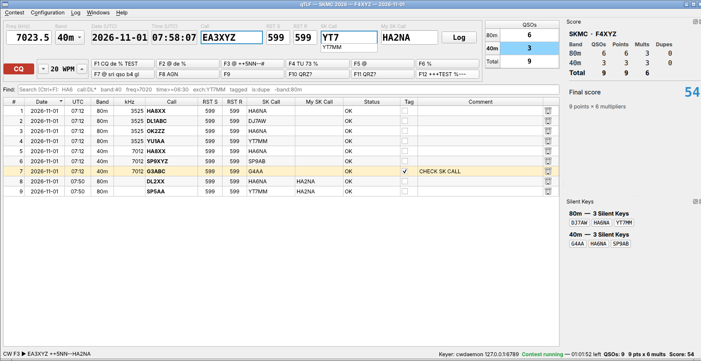

# qTLF

**English** · [Français](README.fr.md)

**User-customizable contest logging software** for radio amateurs.

A contest logger for radio amateurs, written in Qt 6 / C++, inspired by
[TLF](https://tlf.github.io/). Every contest is a user-editable folder in `rules/`
(JSON definition + JavaScript scoring + QML windows), so new contests need no recompilation.



## Features

* **Start-up dialog** — open an existing contest or create a new one from any definition in `rules/`
  (rules + date + callsign + Cabrillo category fields + fixed exchange). The Cabrillo header options
  of the contest (operator, power, club…) can be changed later in **Configuration › Contest options…**
  (score and windows follow at once); the date, the call, the exchange sent and the QSOs are never changed there.
* **Frequency typed by hand** (or band picked from the rules).
* **Entry line** on one row, large fonts: Freq (kHz) / Band · Mode · Date (UTC) · Time (UTC) · Call ·
  RST S · RST R · Exchange received · Exchange sent · **Log** button.
  * Cursor starts in **Call**; **TAB** toggles Call ⇄ Exchange received; **ENTER** logs with the
    date/time of that moment; **Ctrl+ENTER** logs without CW; **ESC** clears; **Ctrl+L** empties
    Call, exchange and search.
  * RST default 599 (from the rules), editable. Exchange sent = fixed value or serial 001, 002…
  * Drop-down lists: **Call** = calls of the log, then of the contest's `call_exchange` CSV file;
    **exchange received** (optional) = exchanges of the log, then of `call_exchange`.
  * TAB pre-fills the exchange received 1. from the log of this contest if the station was already
    worked (F5ABC = F5ABC/P), 2. from `call_exchange` or from a cty.dat field (CQ zone, ITU zone,
    continent…), as set in contest.json (`"prefill": "none"` for serial numbers).
  * Live **DUPE** warning and "worked on" bands while typing (partial calls: in the Call drop-down list).
  * TLF-style: typing a frequency in the Call field (`7025`, `3.535`) QSYs; `:commands` (see `:help`).
* **TRX control** (Hamlib, Linux and Windows — `libhamlib.so.4` / `libhamlib-4.dll` loaded at run time): the rig frequency and mode fill the entry line (band follows),
  a frequency typed in qTLF tunes the rig. RIGMODEL / RIGSPEED / RIGPORT as with `rigctl`, or
  `rigctld` over the network. Configuration › TRX control. See docs/BUILD-LINUX.md.
* **Log window** — every cell editable (double-click), 🗑 delete with confirmation, **Tag** checkbox +
  comment for later review, status column (OK, generic errors found by qTLF — DUPE, OUT OF PERIOD,
  BAND CHANGE, BAD EXCH… — or a contest-specific status from the scoring script).
* **Smart search** — `HA6`, `call:DL*`, `band:40`, `freq>7020`, `time>=06:30`, `date=2026-11-01`,
  `exch:YT7MM`, `tagged`, `is:dupe`, `is:invalid`, `-band:80m` … combined with AND.
* **QSOs per band** summary in the corner.
* **CW keyer** (cwdaemon over UDP): F1–F12 messages with macros, CQ / S&P modes with a smart
  ENTER sequence, auto-CQ (F12), CW speed ±1 WPM (PgUp/PgDn), DUPE → QSO B4 (F7), ESC stops sending. See *CW keyer* below.
* **Clean split program / contest**: the executable does the entry line, keyer,
  log, generic checks (band, mode, periods, minimum time on a band, callsign, exchange, dupes), data files and Cabrillo;
  each contest folder only declares its data in contest.json (`start_utc`/`end_utc` periods, CSV
  files, cty.dat, Cabrillo fields) and computes its score in scoring.js. A new contest = a new folder.
* **Data files**: all CSV (`call_exchange.csv`: known stations and their exchange) except the universal cty.dat
  (continents, DXCC, zones).
* **Data files from the network**: any data file can be downloaded from a URL
  (e.g. GitHub raw) when the contest opens or with Ctrl+U; the local copy is used offline.
* **Custom windows** in docks, written in QML by the contest author (score table, multipliers, rate…).
* **Cabrillo 3.0 export** with a per-contest QSO line template.
* **ADIF 3.1.8 export** (ADI, Contest › Export ADIF, Ctrl+Shift+A or `:adif`) for the general logbook
  (LoTW, QRZ.com, Log4OM…): CALL, QSO_DATE, TIME_ON, BAND, FREQ, MODE/SUBMODE, RST, STX/SRX (serial) or
  STX_STRING/SRX_STRING, CONTEST_ID, STATION_CALLSIGN, MY_GRIDSQUARE, COMMENT, and the qTLF status as
  APP_QTLF_STATUS.
* **Languages**: English (default), French (fr), Italian (it), German (de), Spanish (es); Configuration › Language. Only the user interface is
  translated (rules, QML windows and status codes stay in English). See docs/TRANSLATING.md to add one.
* **SQLite** global database (all contests in one file), portable SQL ready for a remote server later.

## Installation

**Windows 10 / 11** — download `qTLF-<version>-windows.zip` from the
[Releases](https://github.com/f8ehj/qTLF/releases) page, unzip it where you want (e.g. `C:\qTLF`)
and start `qtlf.exe` (right-click › *Send to › Desktop (create shortcut)* for a shortcut).
Nothing is installed in Windows: logs and settings are in `%LOCALAPPDATA%\qTLF` and
`%APPDATA%\qTLF`, so a new version can simply be unzipped next to the old one.
To build it yourself: [docs/BUILD-WINDOWS.md](docs/BUILD-WINDOWS.md) (`deploy-windows.bat`).

**Linux** — build from the sources (a few minutes, see below):

```sh
git clone https://github.com/f8ehj/qTLF.git
cd qTLF
./build-linux.sh --deps     # installs the packages (sudo), builds, installs in ~/.local
```

## Build (Linux)

Full procedure, package lists and troubleshooting: **[docs/BUILD-LINUX.md](docs/BUILD-LINUX.md)**.
Windows (MinGW, `deploy-windows.bat`, Hamlib DLL): **[docs/BUILD-WINDOWS.md](docs/BUILD-WINDOWS.md)**.

```sh
./build-linux.sh --deps     # first time: packages (sudo) + build + install in ~/.local
./build-linux.sh            # rebuild + reinstall
~/.local/bin/qtlf           # or "qTLF" in the desktop menu
./uninstall-linux.sh        # remove everything (keeps qTLF.ini + logs; --all removes them too)
```

Manual equivalent (Debian / Ubuntu):

```sh
sudo apt install build-essential cmake libhamlib-utils qt6-base-dev qt6-declarative-dev libqt6sql6-sqlite \
     qml6-module-qtquick qml6-module-qtquick-layouts qml6-module-qtquick-window qml6-module-qtqml-workerscript \
     qt6-tools-dev qt6-l10n-tools
cmake -S . -B build -DCMAKE_BUILD_TYPE=Release -DCMAKE_INSTALL_PREFIX="$HOME/.local"
cmake --build build -j"$(nproc)"
cmake --install build
```

Where things are:

* **Rules**: first existing of `$QTLF_RULES`, Configuration › Paths › Rules folder, `<exe>/rules`, `<exe>/../share/qtlf/rules`,
  the source tree's `rules/` (development builds), `./rules`.
* **Configuration**: one INI file — Linux/macOS `~/.config/qTLF/qTLF.ini`, Windows `%APPDATA%\qTLF\qTLF.ini`
  (path shown in Configuration and Help › About). TRX control example:
  ```ini
  [trx]
  type=hamlib
  rig_model=3073          ; RIGMODEL (rigctl -l) — 2 = rigctld, rig_port=localhost:4532
  rig_speed=57600         ; RIGSPEED
  rig_port=/dev/ttyUSB0   ; RIGPORT
  poll_ms=500
  set_freq=true
  follow_mode=true
  ```
* **Database**: Configuration › Paths › SQLite database, default `<user data dir>/qTLF/qtlf.sqlite`
  (Linux: `~/.local/share/qTLF/qTLF/qtlf.sqlite`).

## Keys and commands

| Key | Action |
|---|---|
| ENTER | Smart key: CW message of the current step, logs at the end of the sequence (see below) |
| TAB | Call ⇄ exchange received only (pre-fills the exchange); Log button → exchange received; never leaves the entry line |
| ESC | Always stops the CW (keyer stop code, cwdaemon `<ESC>4`) and auto-CQ, then: Call empty → clear Call + exchange · Call filled → clear Call · exchange empty → back to Call · exchange filled → clear exchange |
| + | Toggle CQ / S&P mode |
| F1 … F12 | Send CW message; F12 = auto-CQ on/off. Right-click a key › *Modify message…* |
| PgUp / PgDn | Call empty: CW speed ±1 WPM. Call filled: 2nd digit of the RST instead (cursor in Call → RST sent, cursor in exchange → RST received) |
| Ctrl+ENTER | Log the QSO without sending CW, even if the exchange is missing or invalid (status NO EXCH / BAD EXCH) |
| Ctrl+L | Clear Call, exchange received and the search, cursor in Call |
| Ctrl+↑ / Ctrl+↓ | Band up / down |
| Ctrl+F | Search the log (ESC in the search field clears it) |
| Ctrl+T | Tag the last QSO |
| Ctrl+Shift+E | Export Cabrillo |
| Ctrl+Shift+A | Export ADIF |
| Ctrl+U | Update the contest data files from the network |
| Ctrl+R | Reload scoring.js, data files and QML windows |
| Ctrl+, | Configuration |
| Ctrl+F1 | Keys and commands |
| Del (in the log) | Delete the selected QSO |

Commands typed in the Call field: `7025` (QSY), `:band 40`, `:mode CW`, `:tag text`, `:del`,
`:find text`, `:cab` / `:write`, `:adif`, `:update`, `:score`, `:cfg`, `:reload`, `:open`, `:help`, `:quit`.

## CW keyer

Configuration › Keyer: keyer type (*None* or *cwdaemon*), address (`localhost`), port (`6789`),
hex bytes sent at init (e.g. `1B 30` = cwdaemon reset), default speed (20 WPM),
auto-CQ delay (500–50000 ms, steps of 500 — also from a right-click on F12).
When auto-CQ stops (F12 again or a click on it, ESC, first character typed in an empty Call,
ENTER, another F key) the CW being sent is stopped too (`<ESC>4`).

Configuration › CW messages (or right-click a key): F1–F12, CQ_TU_MSG (13) and S&P_TU_MSG (14).

| Macro | | Passed to cwdaemon as is | |
|---|---|---|---|
| `%` | my call (Configuration › Station) | `*` `=` `<` `(` | AR BT SK KN |
| `@` | call field (`?` if empty) | `!` `&` `>` | SN AS BK |
| `#` | exchange sent | `+` / `-` | speed +2 / −2 WPM (cwdaemon) |
| `[` | RST sent | | |

ENTER sequence:

| Cursor | CQ mode | S&P mode |
|---|---|---|
| Call empty | F1 | my call (`%`) |
| Call filled | F3, go to exchange | F2, go to exchange |
| Exchange empty | F3 | F2 |
| Exchange filled | CQ_TU_MSG (13) + log | S&P_TU_MSG (14), go to the Log button |
| Log button | CQ_TU_MSG (13) + log | log, no CW (TAB: back to the exchange) |
| Call field, call is a DUPE | F7 (QSO B4), stays in Call | F7 (QSO B4), stays in Call |

On the wire (one UDP datagram each): message text in capitals; `<ESC>2<wpm>` when the speed
changes; `<ESC>4` on ESC (cwdaemon `doc/specifications/escape_codes.txt`).

### Testing the keyer output

Without a radio, capture what qTLF sends with Wireshark (Windows: with Npcap, capture the
*Adapter for loopback traffic*; filter `udp.port == 6789`) or Packet Sender in UDP server mode.

## Writing a contest

See **[docs/RULES.md](docs/RULES.md)**. Three examples are included:

* `rules/SKM` — Silent Key Memorial Contest (<https://skmc.hu/en/rules.html>): CW, 80/40 m, exchange
  RST + a Silent Key callsign; 1 point per valid QSO (the received exchange must be a callsign),
  multipliers = different SK callsigns per band, final score = points × multipliers.
* `rules/GENERIC` — template with serial numbers and a rate window.
* `rules/RENCONTRES-UFT` — Rencontres UFT (CW, 3 periods): exchange = UFT member number or NM,
  points by member / non-member and same continent / DX (cty.dat, downloaded automatically),
  multipliers = members per band, member list `UFT_mini_2021.csv` (name and type shown while typing).

## Create a contest folder with an AI

A contest is a folder `rules/<ID>/`: `contest.json` (bands, periods, exchange, dupes, Cabrillo),
`scoring.js` (points, multipliers, score) and `windows/*.qml` (score table, multipliers…).
An AI (Claude, ChatGPT…) can write it from the official rules with the prompt
**[docs/AI-PROMPT-CONTEST.txt](docs/AI-PROMPT-CONTEST.txt)**, which contains the whole qTLF API.

1. Open `docs/AI-PROMPT-CONTEST.txt` and fill in part **A**, in English (A-EN) or in French
   (A-FR) — a few lines:
   ```
   Folder ID (capitals, no space, e.g. REF-CW): REF-CW
   Rules: see the attached PDF
   Windows I would like (QML): score per band, missing departments, station being typed
   Notes: department list attached as CSV; I usually enter SINGLE-OP LOW
   ```
2. In the AI chat, **attach the PDF of the contest rules** (and the CSV files if you have
   them: member list, departments…), paste the **whole** prompt file and send it.
   The AI may ask questions first when the rules are unclear: answer them.
3. The AI answers with one code block per file. Create the folder and save each file with
   exactly the name given (UTF-8 text):
   ```
   rules/REF-CW/contest.json
   rules/REF-CW/scoring.js
   rules/REF-CW/windows/Score.qml
   rules/REF-CW/windows/Station.qml
   rules/REF-CW/call_exchange.csv        (if any)
   ```
   Where is `rules/`? The *New contest* page of the start-up dialog shows it
   (*Rules folder: …*). Linux: `~/.local/share/qtlf/rules/`. Windows portable folder:
   `rules\` next to `qtlf.exe` — when you unzip a new version, copy your own contest folders
   into its `rules\`, or keep them in a folder of yours selected in
   *Configuration › Paths… › Rules folder*.
4. Start qTLF (or *Contest › Open / new contest*): the new contest is in the list. If
   `contest.json` has an error, qTLF says which line; give the message back to the AI.
5. Test with the 5–10 QSOs the AI gave at the end of its answer: the statuses and the score
   must be the expected ones. After editing `scoring.js` or a `.qml` file, **Ctrl+R** reloads
   them without restarting.

The format is described in detail in **[docs/RULES.md](docs/RULES.md)**; the three shipped
contests are good examples.

## Icon

`resources/icons/`: `qtlf.png` (1024 px, transparent background, made from `qtlf-logo-original.png`), `qtlf-16…512.png`, `qtlf.ico`
(Windows), `qtlf.icns` (macOS).

* Windows: embedded in `qtlf.exe` through `resources/qtlf.rc.in` → Explorer,
  taskbar, shortcuts; version information (author F8EHJ) in the file properties.
* All systems: window and taskbar icon set at start-up from the Qt resources (`resources/qtlf.qrc`).
* Linux: `cmake --install` puts `qtlf.desktop` in `share/applications` and the icon in the hicolor theme.
* macOS: built as an app bundle with `qtlf.icns`.

## Credits

qTLF is written by **F8EHJ** (with Claude AI help for clean deployment), in C++ / Qt, inspired by
[TLF](https://tlf.github.io/), the Linux contest logger by PA0R.
Why "TLF"? It's an old joke about someone sending bad CW (Morse code) over the radio, as if
stomping on the key with their foot. TLF stands for "Try Left Foot instead."

## Source layout

```
src/main.cpp               start-up: database, contest selection, main window
src/ContestSelectDialog.*  open / create contest
src/ContestRules.*         contest.json loader (format 2, the only reader of contest.json)
src/QsoChecks.*            generic QSO checks (band, mode, period, call, exchange, dupe)
src/CallDatabase.*, CtyDat.*  CSV call database, cty.dat lookup
src/Database.*             SQLite storage (contests, qsos)
src/MainWindow.*           main window, commands, docks, status bar
src/EntryBar.*             QSO entry line
src/QsoLogModel.*          editable log model
src/LogFilterProxy.*       smart search
src/ScoringEngine.*        runs scoring.js (QJSEngine)
src/ContestBridge.h        "contest" object exposed to QML windows
src/BandSummaryWidget.*    QSOs per band
src/Cabrillo.*             Cabrillo export
src/Adif.*                 ADIF 3.1.8 (ADI) export
src/Translations.*         user-interface language (qtlf_<code>.qm)
translations/qtlf_*.ts     translations fr, it, de, es (Qt Linguist files)
src/SettingsDialog.*       configuration (station, keyer, CW messages, paths)
src/CwConfig.*             CW settings, macros, Morse timing
src/Keyer.*                keyer interface + cwdaemon UDP client
src/TrxConfig.*, Trx.*     TRX control interface ([trx] in the INI file)
src/HamlibApi.*            Hamlib loaded at run time (dlopen / LoadLibrary), no SDK needed
src/HamlibTrx.*            Hamlib backend (worker thread, polling, reconnection)
src/CwPanel.*              CQ/S&P, speed, F1–F12 keys
src/MainWindowCw.cpp       ENTER sequence, auto-CQ, ESC, speed
src/AboutDialog.*          Help › About
src/RemoteFiles.*          download of data files that have a url (GitHub raw…)
resources/                 icons, Qt resources, Windows .rc, Linux .desktop
docs/AI-PROMPT-CONTEST.txt prompt to create a contest folder with an AI
```

## Roadmap ideas

Remote database (QPSQL / QMYSQL driver), WinKeyer and Windows/macOS keyers, CW keyboard mode, other TRX backends (OmniRig, Flrig),
band map / DX cluster, network multi-op.
